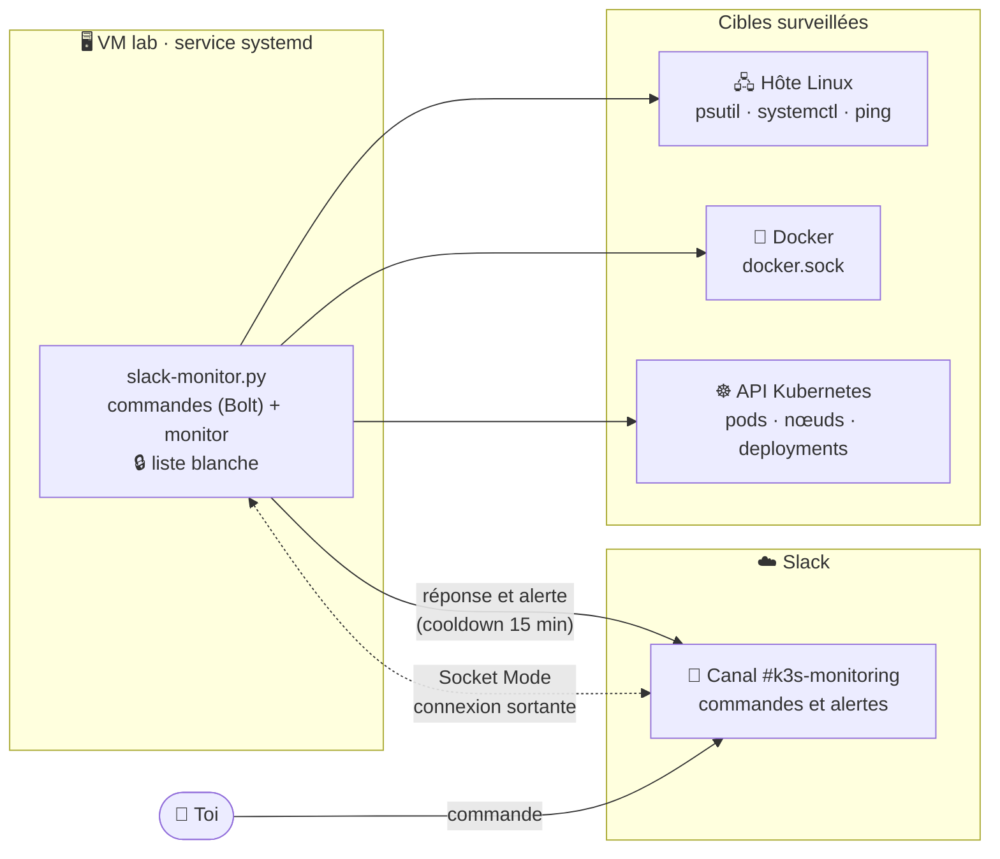
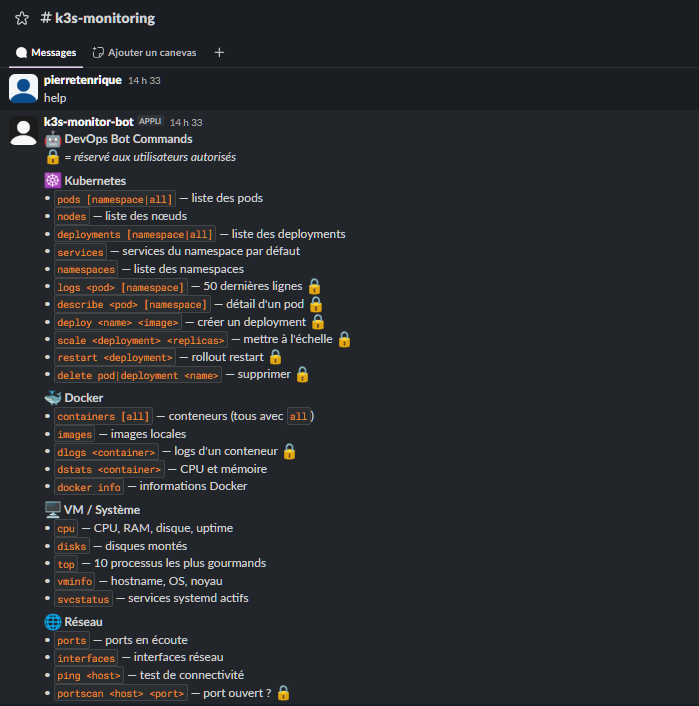
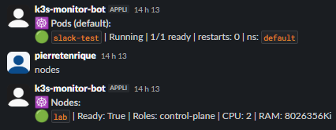
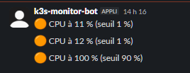

cluster-monitor-slack-bot


Bot Slack de supervision DevOps. Il interroge ton cluster Kubernetes, tes conteneurs Docker et l'hôte Linux, exécute quelques actions protégées, et envoie des alertes dans un canal.
Il fonctionne en Socket Mode : la connexion est sortante, aucun port n'est exposé.
Fonctionnalités
Kubernetes : pods, nœuds, deployments, services, namespaces, logs et détail d'un pod
Actions protégées : déployer, mettre à l'échelle, redémarrer, supprimer
Docker : conteneurs, images, logs, statistiques CPU et mémoire
Hôte : CPU, RAM, disques, processus, interfaces, ports en écoute, services systemd
Réseau : ping et test d'ouverture de port
Alertes : nœuds non prêts, pods en échec ou en `CrashLoopBackOff`, seuils CPU, RAM et disque, avec cooldown anti-spam
Sécurité : liste blanche d'utilisateurs Slack, validation des entrées, erreurs génériques
Architecture

Le bot ouvre lui-même la connexion vers Slack : aucun port entrant n'est nécessaire.
Les contrôles de l'hôte mesurent la machine sur laquelle tourne le service.
Prérequis
Python 3.12
Un kubeconfig fonctionnel pour l'utilisateur qui lance le bot : `kubectl get nodes` doit répondre
Docker, optionnel : accès à `/var/run/docker.sock`
Une app Slack installable dans ton workspace
Installation
```bash
git clone https://github.com/epierret/cluster-monitor-slack-bot.git
cd cluster-monitor-slack-bot
python3 -m venv .venv
.venv/bin/pip install -r requirements.txt
```
Créer l'app Slack
Sur api.slack.com/apps, crée une app From scratch dans ton workspace.
OAuth & Permissions → Bot Token Scopes : ajoute `chat:write` et `channels:history`.
Socket Mode : active-le (menu Settings).
Basic Information → App-Level Tokens : génère un token avec le scope `connections:write`. C'est ta `SLACK_APP_TOKEN` (`xapp-…`).
Event Subscriptions : active-les et ajoute l'événement bot `message.channels`.
OAuth & Permissions → Install to Workspace. Copie le Bot User OAuth Token : c'est ta `SLACK_BOT_TOKEN` (`xoxb-…`).
Dans le canal d'alertes : Intégrations → Ajouter des applis → ton bot.
Configuration
Toute la configuration passe par des variables d'environnement.
Variable	Obligatoire	Défaut	Rôle
`SLACK_BOT_TOKEN`	oui	—	Token du bot (`xoxb-…`)
`SLACK_APP_TOKEN`	oui	—	Token Socket Mode (`xapp-…`)
`ALLOWED_SLACK_USERS`	non	vide	IDs Slack autorisés à exécuter les commandes 🔒, séparés par des virgules. Vide : aucune commande sensible
`ALERT_CHANNEL`	non	vide	ID du canal d'alertes. Vide : les alertes ne sont que journalisées
`DEFAULT_NAMESPACE`	non	`default`	Namespace utilisé par défaut
`KUBECONFIG`	non	`~/.kube/config`	Chemin du kubeconfig. Sinon, configuration in-cluster
`MONITOR_INTERVAL`	non	`60`	Secondes entre deux contrôles
`ALERT_COOLDOWN`	non	`900`	Secondes avant de renvoyer une même alerte
`CPU_THRESHOLD`	non	`90`	Seuil CPU en %
`RAM_THRESHOLD`	non	`90`	Seuil RAM en %
`DISK_THRESHOLD`	non	`85`	Seuil disque `/` en %
Mets les secrets dans un fichier réservé à root, hors du repo :
```bash
sudo cp .env.example /etc/slack-monitor.env
sudo chown root:root /etc/slack-monitor.env
sudo chmod 600 /etc/slack-monitor.env
sudo nano /etc/slack-monitor.env
```
Lancer le bot
Test rapide : exporte les variables dans ton shell, puis lance le script.
```bash
.venv/bin/python slack-monitor.py
```
En service systemd : utilise un utilisateur dédié, sans droits root.
```bash
sudo useradd --system --create-home monitor
sudo mkdir -p /opt/cluster-monitor-slack-bot
sudo cp slack-monitor.py requirements.txt /opt/cluster-monitor-slack-bot/
sudo python3 -m venv /opt/cluster-monitor-slack-bot/.venv
sudo /opt/cluster-monitor-slack-bot/.venv/bin/pip install -r /opt/cluster-monitor-slack-bot/requirements.txt
sudo mkdir -p /home/monitor/.kube   # puis copie un kubeconfig dédié dans /home/monitor/.kube/config
sudo chown -R monitor:monitor /home/monitor/.kube
sudo cp k3s-slackbot.service /etc/systemd/system/
sudo systemctl daemon-reload
sudo systemctl enable --now k3s-slackbot
journalctl -u k3s-slackbot -f
```
Tu dois voir `Bot démarré` puis `Surveillance active toutes les 60 s`.
Commandes
Tape `help` dans le canal pour afficher la liste complète.

Les commandes marquées 🔒 sont réservées aux IDs de `ALLOWED_SLACK_USERS`.
Commande	Description	
`help`	Affiche l'aide	
`namespaces`	Liste des namespaces	
`pods [namespace|all]`	Pods d'un namespace, ou de tous	
`nodes`	Nœuds et leur état `Ready`	
`deployments [namespace|all]`	Deployments et nombre de réplicas	
`services`	Services du namespace par défaut	
`logs <pod> [namespace]`	50 dernières lignes de logs	🔒
`describe <pod> [namespace]`	Détail d'un pod	🔒
`deploy <nom> <image>`	Crée un deployment à 1 réplica	🔒
`scale <deployment> <n>`	Met à l'échelle (50 réplicas max)	🔒
`restart <deployment>`	Rollout restart	🔒
`delete pod|deployment <nom>`	Supprime une ressource	🔒
`containers [all]`	Conteneurs Docker (tous avec `all`)	
`images`	Images Docker locales	
`dlogs <conteneur>`	Logs d'un conteneur Docker	🔒
`dstats <conteneur>`	CPU et mémoire d'un conteneur	
`docker info`	Informations du daemon Docker	
`cpu`	CPU, RAM, disque `/`, uptime	
`disks`	Partitions montées	
`top`	10 processus les plus gourmands	
`vminfo`	Hostname, OS, noyau	
`svcstatus`	Services systemd actifs	
`ports`	Ports TCP en écoute	
`interfaces`	Interfaces réseau et trafic	
`ping <hôte>`	Test de connectivité	
`portscan <hôte> <port>`	Port ouvert ou fermé	🔒
Exemple de sortie avec `pods` et `nodes` :

Alertes
Le monitor contrôle les nœuds, les pods et l'hôte toutes les `MONITOR_INTERVAL` secondes. Il envoie une alerte dans `ALERT_CHANNEL` quand :
un nœud n'est pas `Ready` ;
un pod est en échec, ou bloqué en `CrashLoopBackOff`, `ImagePullBackOff`, `ErrImagePull` ou `CreateContainerConfigError` ;
le CPU, la RAM ou le disque `/` dépasse son seuil.
Une même alerte n'est renvoyée qu'après `ALERT_COOLDOWN` secondes.
Pour tester sans attendre une vraie panne, mets temporairement `CPU_THRESHOLD=1` dans `/etc/slack-monitor.env` et redémarre le service.
Pour un test réaliste, garde le seuil à 90 % et crée de la charge sur tous les cœurs de la VM. La commande s'arrête d'elle-même après 2 minutes. L'alerte arrive au plus tard 60 secondes après le début :
```bash
for i in $(seq $(nproc)); do timeout 120 sh -c 'while :; do :; done' & done
```
Pour arrêter la charge avant la fin :
```bash
pkill -f 'while :; do :; done'
```
Lance ces commandes uniquement sur la VM de test.

Sécurité
Liste blanche : seuls les IDs de `ALLOWED_SLACK_USERS` exécutent les commandes 🔒. Une liste vide bloque toutes ces commandes.
Entrées validées : noms Kubernetes (DNS-1123), hôtes, images et ports sont vérifiés par expression régulière avant tout appel.
Erreurs génériques : Slack reçoit un message neutre ; le détail part dans les logs du service.
Pas de shell : `ping` et `systemctl` sont appelés directement, et l'hôte est précédé de `--`.
Secrets hors du code : les tokens sont dans `/etc/slack-monitor.env` (root, 600). Ne les mets jamais dans le repo ni dans un message.
Moindre privilège : utilise un kubeconfig dédié, avec un Role limité aux namespaces et aux verbes nécessaires. Évite `cluster-admin`.
Docker équivaut à root : l'accès à `docker.sock` donne les droits root. N'ajoute `monitor` au groupe `docker` que si tu utilises les commandes Docker.
Logs visibles : `logs` et `dlogs` publient le contenu dans Slack, lisible par tout le canal. Évite-les sur des pods qui manipulent des secrets.
Dépannage
Symptôme	Cause probable	Solution
`Variable d'environnement manquante`	Le fichier d'environnement n'est pas lu	Vérifie `EnvironmentFile=` et les droits du fichier
`invalid_auth`	Token incorrect ou révoqué	Recopie le `xoxb-` depuis OAuth & Permissions
`not_in_channel`	Le bot n'est pas dans le canal	Intégrations → Ajouter des applis
`status=200/CHDIR`	`WorkingDirectory` inexistant	Corrige le chemin dans l'unité systemd
`Non autorisé`	Ton ID n'est pas dans la liste	Ajoute-le à `ALLOWED_SLACK_USERS`
`Start request repeated too quickly`	Limite de redémarrage atteinte	`sudo systemctl reset-failed k3s-slackbot`
Aucune réponse en message privé	L'onglet Messages de l'app est désactivé	Utilise le canal
Développement
```bash
pip install ruff
ruff check .
python -m py_compile slack-monitor.py
```
La CI exécute ces contrôles à chaque push et pull request.
Feuille de route
[ ] Tests unitaires des validateurs et du contrôle d'accès
[ ] Manifest Slack prêt à importer
[ ] Manifest RBAC (ServiceAccount et Role à moindre privilège)
[ ] Métriques Prometheus
Licence
MIT. Voir LICENSE.
